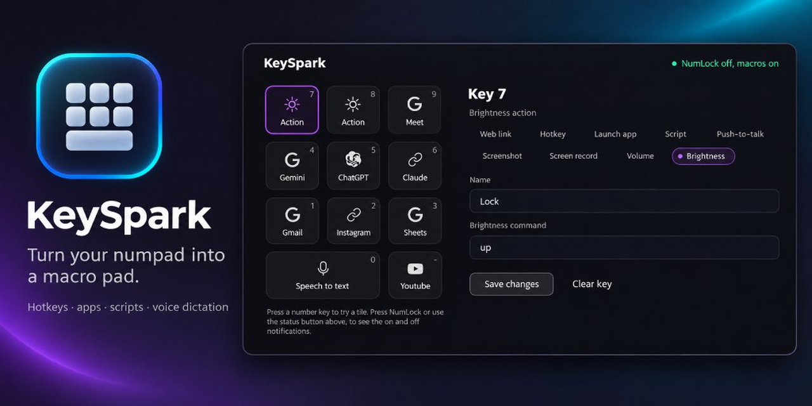
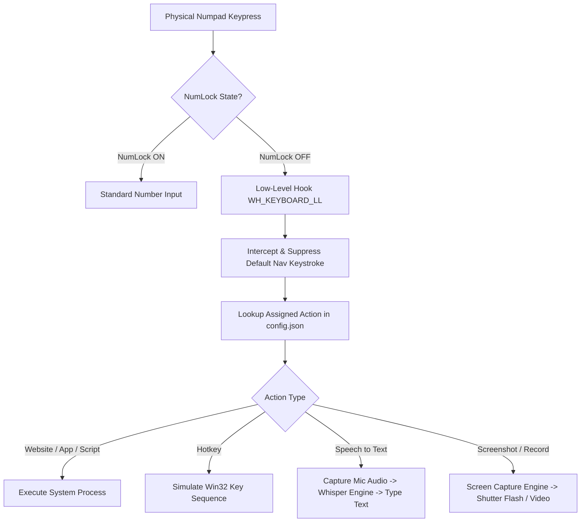

**KeySpark** — turn any numpad into a silent Stream Deck for Windows. Assign hotkeys, URLs, apps, scripts, or speech-to-text assign to a key. No scripting, no extra hardware.

<!-- Replace with demo GIF once recorded, currently showcasing the social preview banner -->


```powershell
# One-command launch — no Python required (PowerShell)
irm https://github.com/Abhiyaan2003/KeySpark/releases/latest/download/KeySpark-v2.1.0-windows-x64.zip -OutFile KeySpark.zip; Expand-Archive KeySpark.zip -DestinationPath KeySpark; .\KeySpark\KeySpark.exe
```

<p align="center">
  <a href="https://github.com/Abhiyaan2003/KeySpark/releases/latest"></a>
  <a href="https://youtu.be/YOUR_VIDEO_ID"></a>
  <a href="https://github.com/Abhiyaan2003/KeySpark/actions/workflows/ci.yml"></a>
  <a href="LICENSE"></a>
</p>

<p align="center">
  
  
  
  
</p>

---

## 🌟 Overview

**KeySpark** is a high-performance Windows desktop application designed to transform any standard physical USB or Bluetooth numeric keypad into a fully custom macro controller (Stream Deck alternative).

By hooking low-level Windows keyboard inputs via `WH_KEYBOARD_LL`, KeySpark selectively intercepts keypresses **only when `NumLock` is turned OFF**, leaving standard numeric typing when `NumLock` is ON 100% untouched.

---

## ✨ Key Features

- 🎙️ **Speech to Text (Offline Whisper AI)**: Hold a key to speak and automatically transcribe voice directly to your active cursor position using local `faster-whisper` (`base` model). Includes real-time floating visual overlay feedback.
- 🌐 **Web & App Launcher**: Instantly launch websites in your preferred browser (Chrome, Firefox, Edge, Brave) or open executables/scripts.
- ⌨️ **Global Hotkey Dispatcher**: Trigger complex keyboard combinations (e.g. `Ctrl+Shift+T`, `Win+D`, `Alt+Tab`) with a single keypress.
- 📸 **Screen Capture Engine**: Capture full screen, primary monitor, or active window snapshots complete with a custom visual shutter flash.
- 🎥 **Screen Recording Engine**: Record screen sessions directly with smooth MP4 output.
- ⌨️ **Physical Keymap Editor**: A minimal-glass PyQt6 workspace that mirrors the 11-key numpad, shows each key’s current action, and keeps its binding editor alongside the map. Light and dark appearances are supported.
- 🤫 **Silent System Tray Operation**: Runs unobtrusively in the background with quick profile switching and tray controls.

---

## 🎨 Interface appearance

The Glass editor is the default. Open **Settings** to follow Windows light/dark mode or choose an appearance directly. The Classic editor remains available as a theme option and takes effect after restarting the app. The visual specification is in [DESIGN.md](DESIGN.md). To preview the Glass editor without starting the keyboard hook or action engines, run `python dev_preview.py`.

---

## 🎹 Physical Numpad Mapping

KeySpark maps the **11 primary navigation keys** available on a standard numeric keypad when `NumLock` is **OFF**:

| Key Position | Virtual Key | Human Label | Default Purpose |
| :--- | :--- | :--- | :--- |
| **Num 7** | `VK_HOME` (0x24) | `7 / Home` | Customizable Macro |
| **Num 8** | `VK_UP` (0x26) | `8 / ↑` | Customizable Macro |
| **Num 9** | `VK_PRIOR` (0x21) | `9 / PgUp` | Customizable Macro |
| **Num 4** | `VK_LEFT` (0x25) | `4 / ←` | Customizable Macro |
| **Num 5** | `VK_CLEAR` (0x0C) | `5 / Clear` | Customizable Macro |
| **Num 6** | `VK_RIGHT` (0x27) | `6 / →` | Customizable Macro |
| **Num 1** | `VK_END` (0x23) | `1 / End` | Customizable Macro |
| **Num 2** | `VK_DOWN` (0x28) | `2 / ↓` | Customizable Macro |
| **Num 3** | `VK_NEXT` (0x22) | `3 / PgDn` | Customizable Macro |
| **Num 0** | `VK_INSERT` (0x2D) | `0 / Insert` | Speech to Text (STT) |
| **Num .** | `VK_DELETE` (0x2E) | `. / Delete` | Customizable Macro |

---

## ⚡ Supported Action Types

1. **Open Website**: Launch target URLs with custom browser choices (`Default`, `Chrome`, `Firefox`, `Edge`, `Brave`).
2. **Send Hotkey**: Send system hotkey sequences (`ctrl+shift+t`, `alt+f4`, `win+shift+s`).
3. **Launch Application**: Execute binaries or shortcuts (`.exe`, `.lnk`).
4. **Run Script**: Execute automation scripts (`.bat`, `.ps1`, `.py`).
5. **Speech to Text**: Offline Whisper voice dictation typed directly into focused input fields.
6. **Take Screenshot**: Instant screen grab with scope selection (`Full Screen`, `Active Window`, `Primary Monitor`).
7. **Screen Record**: Smooth video screen recorder with target region control.

---

## 📐 Architecture & How It Works



---

## 💻 Developer Setup (Build from Source)

### Prerequisites

- **Windows 10 / 11** (64-bit)
- **Python 3.12+**
- Active microphone (for Speech to Text feature)

### Step-by-Step Build Instructions

1. **Clone repository**:
   ```bash
   git clone https://github.com/Abhiyaan2003/KeySpark.git
   cd KeySpark
   ```

2. **Create virtual environment & install dependencies**:
   ```bash
   python -m venv venv
   venv\Scripts\activate
   pip install -r requirements.txt
   ```

3. **Run application locally**:
   ```bash
   python main.py
   ```

4. **Compile Standalone Executable**:
   ```bash
   pyinstaller KeySpark.spec --noconfirm
   ```
   *The standalone binary will be output to `dist/KeySpark/KeySpark.exe`.*

---

## 🛠️ Project Structure

```
KeySpark/
├── main.py                  # Application entry point & Qt lifecycle
├── gui.py                   # PyQt6 Main Window & Numpad visual layout
├── hook.py                  # Windows WH_KEYBOARD_LL low-level input hook
├── ptt_engine.py            # Local faster-whisper Speech-to-Text engine
├── ptt_overlay.py           # Speech-to-Text floating live dictation UI
├── screen_engine.py         # Screenshot & screen recording engine
├── flash_overlay.py         # Screenshot visual shutter flash overlay
├── actions.py               # Action dispatch & macro execution pipeline
├── config.py                # Configuration management (config.json)
├── tray.py                  # System tray icon & context menu
├── assets/                  # High-contrast Hugeicons vector SVGs
├── requirements.txt         # Python project dependencies
└── KeySpark.spec            # PyInstaller build specification
```

---

## 📄 License

Distributed under the [MIT License](LICENSE).

---

<p align="center">
  Built with ❤️ for productivity & macro automation.
</p>
